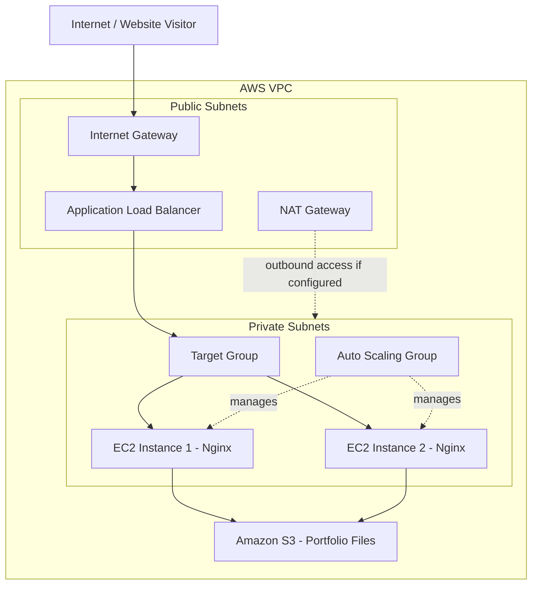

# AWS Production Portfolio Website | Terraform


## 📌 Project Overview

This project demonstrates the deployment of a production-style portfolio website on **Amazon Web Services (AWS)** using **Terraform (Infrastructure as Code)**.

The infrastructure is designed to host a static portfolio website stored in Amazon S3 and served through Nginx on Amazon EC2 instances. An Application Load Balancer distributes incoming traffic across instances managed by an Auto Scaling Group.

The infrastructure is organized into reusable Terraform modules to make provisioning, configuration, and maintenance easier.

**Repository:** [aws-production](https://github.com/navald1234/aws-production)

## 🏗️ Architecture

The project uses a multi-tier AWS architecture with public-facing load balancing and private application instances.



### Architecture Workflow

1. Visitors access the website through the Application Load Balancer.
2. The ALB forwards incoming requests to the Target Group.
3. The Target Group distributes requests to healthy EC2 instances.
4. EC2 instances run Nginx to serve the portfolio website.
5. Website files are stored in Amazon S3.
6. EC2 User Data installs Nginx and AWS CLI and synchronizes website files from S3.
7. The Auto Scaling Group maintains the desired EC2 capacity.
8. Terraform manages the AWS infrastructure through reusable modules.

## ☁️ AWS Services Used

| AWS Service | Purpose |
|---|---|
| Amazon VPC | Isolated cloud networking |
| Public Subnets | Host internet-facing infrastructure |
| Private Subnets | Host application EC2 instances |
| Internet Gateway | Internet connectivity for public resources |
| NAT Gateway | Outbound internet access for private resources, if configured |
| Amazon S3 | Stores static website files |
| Amazon EC2 | Runs the Nginx web server |
| Launch Template | Defines EC2 launch configuration |
| Auto Scaling Group | Maintains EC2 instance capacity |
| Application Load Balancer | Distributes incoming HTTP traffic |
| Target Group | Registers instances and performs health checks |
| IAM | Controls permissions and access |
| Amazon CloudWatch | Supports monitoring and scaling metrics |

## 🛠️ Technologies Used

- Terraform
- AWS CLI
- Linux
- Bash scripting
- Nginx
- Git and GitHub
- HCL (HashiCorp Configuration Language)

## 📂 Project Structure

The repository follows a modular Terraform approach.

```text
aws-production/
│
├── Modules/
│   └── compute/
│       ├── asg/
│       │   ├── main.tf
│       │   ├── variable.tf
│       │   └── outputs.tf
│       │
│       └── lt/
│           ├── main.tf
│           ├── variable.tf
│           ├── outputs.tf
│           └── userdata.sh
│
├── Environments/
│   └── compute/
│       ├── asg/
│       │   └── dev/
│       │       ├── main.tf
│       │       ├── data.tf
│       │       ├── backend.tf
│       │       └── variable.tf
│       │
│       └── lt/
│           └── dev/
│               ├── main.tf
│               ├── data.tf
│               ├── backend.tf
│               └── variable.tf
│
└── README.md
```

*Note: This shows the main compute module and environment files. Other networking, storage, and load-balancing files are part of the wider project.*

## ⚙️ Key Features

### 1. Infrastructure as Code

- AWS resources provisioned using Terraform.
- Reusable Terraform modules.
- Environment-based configuration.
- Remote Terraform state stored in Amazon S3.

### 2. Automated EC2 Configuration

EC2 User Data automatically:

- Updates the operating system.
- Installs Nginx.
- Installs AWS CLI.
- Starts and enables the Nginx service.
- Synchronizes website files from S3.

### 3. High Availability and Load Balancing

- Application Load Balancer handles incoming requests.
- Target Group performs EC2 health checks.
- Multiple EC2 instances run behind the ALB.
- Auto Scaling Group manages instance capacity.

### 4. Automatic Scaling

Configured a target tracking scaling policy based on average EC2 CPU utilization.

### 5. IAM Permissions

Used an EC2 IAM role and instance profile to grant the application server the permissions required to access S3.

## 🚀 Deployment Workflow

### Prerequisites

Install and configure:

- AWS CLI
- Terraform
- Git
- An AWS account with the required IAM permissions

Configure AWS credentials:

```bash
aws configure
```

Verify the configuration:

```bash
aws sts get-caller-identity
```

### Step 1: Clone the Repository

```bash
git clone https://github.com/navald1234/aws-production.git

cd aws-production
```

### Step 2: Initialize Terraform

Navigate to the required environment directory and initialize Terraform.

```bash
terraform init
```

### Step 3: Validate Configuration

```bash
terraform validate
```

### Step 4: Review Infrastructure Changes

```bash
terraform plan
```

### Step 5: Deploy Infrastructure

```bash
terraform apply
```

**Important:** Deploy infrastructure in dependency order. Configure the backend, networking, storage, security, load balancing, Launch Template, and Auto Scaling Group according to the repository's remote-state dependencies.

Review each Terraform plan before applying it.

## 🔧 EC2 User Data Script

The following commands automate the web server configuration:

```bash
#!/bin/bash

yum update -y

yum install -y nginx awscli

systemctl enable nginx
systemctl start nginx

aws s3 sync s3://${bucket_name}/ /usr/share/nginx/html/

chown -R nginx:nginx /usr/share/nginx/html/

systemctl restart nginx
```

This allows newly launched EC2 instances to configure the web server and retrieve the website files automatically.

## 🧪 Troubleshooting and Challenges

During deployment, I encountered and resolved several AWS infrastructure issues.

| Challenge | Root cause | Resolution |
|---|---|---|
| EC2 Free Tier eligibility error | Selected instance type was not eligible under the account restrictions | Checked eligible instance types using AWS CLI |
| AMI architecture mismatch | ARM instance type was paired with an x86_64 AMI | Selected an architecture-compatible instance type |
| 502 Bad Gateway | Backend response was initially unavailable | Investigated ASG, EC2 and Target Group health |
| Target Group health verification | Needed to confirm backend availability | Used AWS CLI to inspect registered target health |
| Terraform resource replacement | ASG lifecycle and state required careful handling | Reviewed Terraform plans and recreated the ASG |

### Useful AWS CLI Commands

**Check Auto Scaling Group instances:**

```bash
aws autoscaling describe-auto-scaling-groups \
  --auto-scaling-group-names dev-web-asg \
  --region ap-south-1
```

**Check Target Group health:**

```bash
aws elbv2 describe-target-health \
  --target-group-arn YOUR_TARGET_GROUP_ARN \
  --region ap-south-1
```

**Check eligible EC2 instance types:**

```bash
aws ec2 describe-instance-types \
  --region ap-south-1 \
  --filters "Name=free-tier-eligible,Values=true" \
  --query "InstanceTypes[].InstanceType" \
  --output table
```

## 📈 Project Outcome

Successfully deployed and accessed the portfolio website through the Application Load Balancer.

The deployed configuration was verified with:

- Two EC2 instances in `InService` state.
- Both instances reporting `Healthy` in the Auto Scaling Group.
- Both registered Target Group targets reporting `healthy`.
- Terraform successfully creating the Auto Scaling Group and CPU tracking policy.

## 🎯 What I Learned

Through this project, I gained hands-on experience with:

- AWS cloud infrastructure provisioning.
- Terraform modules and remote state management.
- VPC networking and subnet architecture.
- EC2 Launch Templates and User Data.
- Auto Scaling Groups and scaling policies.
- Application Load Balancer and Target Groups.
- IAM roles and policies.
- S3 integration with EC2.
- AWS CLI troubleshooting.
- Debugging real deployment issues.

## 🔮 Future Improvements

- Add HTTPS using AWS Certificate Manager.
- Configure a custom domain using Amazon Route 53.
- Improve monitoring and alerting using CloudWatch.
- Add a CI/CD pipeline using GitHub Actions.
- Add automated infrastructure testing.
- Improve deployment security and cost optimization.

## 👨‍💻 Author

**Naval Dhake**

MCA Student | Aspiring Cloud / DevOps Engineer

- GitHub: [navald1234](https://github.com/navald1234)
- Project: [aws-production](https://github.com/navald1234/aws-production)

---

⭐ If you find this project useful, consider giving the repository a star.

**Built with AWS, Terraform, and hands-on learning.**
## 📸 Project Screenshots

### 1. AWS Architecture


### 2. Website Preview


### 3. AWS Infrastructure


### 4. Deployment Verification
